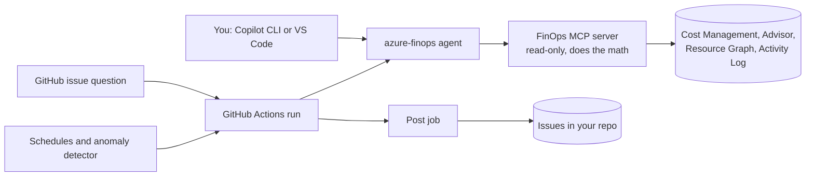

# azure-finops-agent

A read-only Azure FinOps agent built on GitHub Copilot. Ask it about Azure spend in Copilot CLI, VS Code, or a GitHub issue, and it answers with an evidence id behind every number. Scheduled reports and anomaly investigations run in GitHub Actions and post to issues in your repository.

It's a template: create your own private copy, point it at your subscriptions, and run it with your own Copilot plan and Azure access.

> Figures come from Azure Cost Management and Advisor through read-only queries. The agent can still misread a question or a result, so verify before acting. Advisor savings are Advisor's estimates.

## What it does

- **Answers cost questions**: spend by service, resource group, tag, or resource; period comparisons with like-for-like day counts; what drove a change.
- **Investigates anomalies**: a deterministic detector flags unusual daily spend, and the agent correlates it with Activity Log and resource changes, with a confidence level.
- **Summarizes savings**: Advisor cost recommendations ranked by savings and routed to owning teams.
- **Runs on a schedule**: describe a report in plain language ("first business day of the month"), review the generated YAML in a pull request, and it runs from then on.
- **Never changes Azure**: the MCP server only allows a fixed list of read requests, and the identity it uses in Actions has Reader and Cost Management Reader only.



## Quickstart

Interactive use, with your own `az login`. You need Python 3.11+, Node.js 22+, the Azure CLI, a Copilot plan with Copilot CLI, and Reader plus Cost Management Reader on the subscriptions.

```bash
gh repo create my-org/finops --private --template sabajamalian/azure-finops-agent --clone
cd finops
cp finops/config.example.yaml finops/config.yaml   # set azure.tenant_id and azure.subscriptions
python3 -m venv .venv && source .venv/bin/activate
pip install ./mcp-server
npm install --global @github/copilot@1.0.98
az login --tenant <tenant-id>
finops doctor --skip-github
copilot --agent azure-finops
```

Then ask something like "Why did spend in contoso-prod go up last week?" Headless runs (issue questions, schedules, anomalies) need one more step: `scripts/setup/setup.sh` creates a read-only managed identity and configures the repository. See [setup](docs/setup.md#5-set-up-headless-runs).

## Before you use it

- **Keep the repository private.** Issues, workflow logs, and run artifacts contain spend data. The post job refuses to publish to a public repository unless you override it.
- **Copilot is the cost.** Each prompt, issue question, scheduled report, and anomaly investigation uses premium requests. The Azure reads are free. See [Cost of running it](docs/usage.md#cost-of-running-it).
- **Check your Copilot plan's training setting.** On Copilot Free, Pro, and Pro+, interaction data is used for model training unless you opt out. Business and Enterprise data isn't. See [Model training](docs/data-handling.md#model-training).
- **Not yet run end to end.** The test suite runs against synthetic Azure data and mocked GitHub APIs. A live run against a real subscription and Copilot in Actions is the first thing to try after setup. See [Open questions](docs/security.md#open-questions).

## Documentation

| Doc | What's in it |
| --- | --- |
| [Setup](docs/setup.md) | Prerequisites, config, interactive use, headless runs, teardown |
| [Usage](docs/usage.md) | Example questions, issue questions, automations, anomaly detection, CLI reference |
| [Architecture](docs/architecture.md) | MCP server, tools, headless run flow, task record, detector, design decisions, what's not in this version |
| [Security](docs/security.md) | Permissions, who can start a run, prompt injection, supply chain, known limitations |
| [Data handling](docs/data-handling.md) | What's stored where, retention and deletion, model hosting, training |

## Repository layout

| Path | Contents |
| --- | --- |
| [`.github/agents/azure-finops.agent.md`](.github/agents/azure-finops.agent.md) | Agent profile: scope, financial rules, answer format, allowed tools |
| [`.github/workflows/`](.github/workflows) | `finops-run` (headless runs), `finops-ask`, `finops-dispatch`, `finops-anomaly`, `finops-evals`, `ci` |
| [`mcp-server/`](mcp-server) | The FinOps MCP server and `finops` CLI (Python) |
| [`finops/`](finops) | Config example, tool allow-list, automations, context files, JSON schemas |
| [`scripts/setup/`](scripts/setup) | `setup.sh` and Bicep for the managed identity and role assignments |
| [`evals/`](evals/README.md) | Agent eval cases against synthetic data |

## Development

```bash
pip install -e "./mcp-server[dev]"
cd mcp-server && ruff format --check . && ruff check . && pytest
```

CI also checks that the JSON schemas are current (`finops schemas export --check`), that the agent profile matches the allow-list (`finops check-agent-profile`), that automations are valid, and runs actionlint on the workflows.
