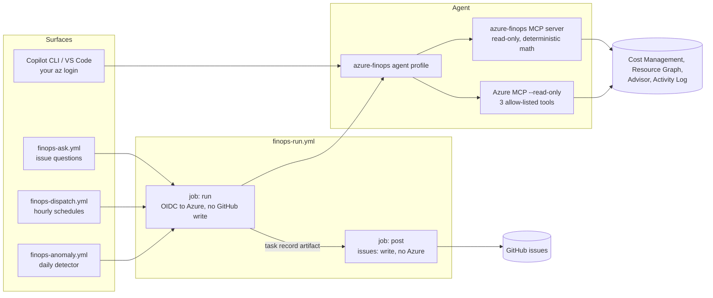
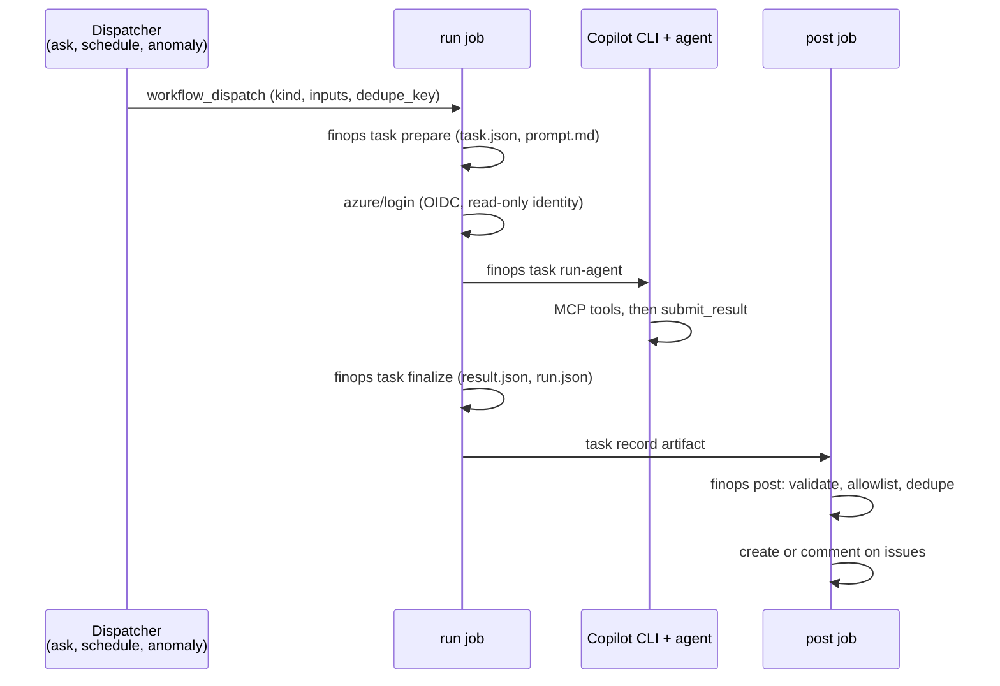

# Architecture

The agent has three parts:

- **Agent profile** ([`.github/agents/azure-finops.agent.md`](../.github/agents/azure-finops.agent.md)): persona, scope, financial rules, answer format, and the exact tools the agent may call.
- **FinOps MCP server** ([`mcp-server/`](../mcp-server)): a read-only Python MCP server that owns every Azure call and every number. The model never does cost math itself.
- **Workflows** ([`.github/workflows/`](../.github/workflows)): headless runs in GitHub Actions for questions asked on issues, scheduled reports, and anomaly investigations.

## FinOps MCP server

Every tool goes through the same core:

| Piece | What it does | Code |
| --- | --- | --- |
| Credentials | `DefaultAzureCredential`. Interactive runs use your `az login`; Actions uses the managed identity through OIDC and `AZURE_TOKEN_CREDENTIALS=AzureCliCredential`. | `arm.py` |
| Read-only client | An explicit allow-list of method and path patterns: a few `GET` paths (subscriptions, Activity Log, Advisor, permissions) and `POST` only to Cost Management `query` and `forecast` and Resource Graph `resources`. Requests to unlisted paths, or to subscriptions not in `finops/config.yaml`, raise before anything is sent. Every tool is annotated `readOnlyHint`. | `arm.py` |
| Rate limits and retries | Token bucket for Cost Management QPU limits; honors `x-ms-ratelimit-microsoft.costmanagement-qpu-retry-after` and `Retry-After`; retries 429 and 5xx with backoff, then fails with a clear message. | `ratelimit.py`, `arm.py` |
| Cache | On-disk response cache in `.finops/cache/`, keyed by request hash, 15-minute TTL (`FINOPS_CACHE_TTL`). | `arm.py`, `runtime.py` |
| Datasets | Large results go into an in-memory SQLite table. The tool returns a summary and a `dataset_id`; `query_dataset` runs `SELECT`-only SQL on it. | `datasets.py` |
| Evidence | Every numeric result gets an evidence id (`ev-001`, ...) with scope, UTC period, granularity, cost basis, currency, row count, partial-period flags, data-through date, query hash, and the Azure request id. | `evidence.py` |
| Capability gating | `get_capabilities` probes each data source per subscription. Missing access comes back as `status: unavailable` with the role and scope that's missing, so the agent reports it instead of failing. | `scopes.py`, `errors.py` |
| Audit | Each tool call, Azure request, and posted issue is appended to `audit.jsonl`, with tokens and signatures redacted. | `audit.py` |

### Tools

| Tool | Purpose | Azure source |
| --- | --- | --- |
| `get_capabilities` | Which data sources this identity can read, per subscription | probes |
| `list_scopes` | Configured subscriptions, resource groups, cost basis, timezone | Resource Graph |
| `query_costs` | Cost for a subscription or resource group, grouped and filtered | Cost Management query |
| `compare_periods` | Two periods with like-for-like day counts: deltas, percent change, share of change, new spend, reconciliation | Cost Management query |
| `explain_drivers` | Drill down from services to the resources and meters that moved most | Cost Management query |
| `get_advisor_cost_recommendations` | Advisor cost recommendations with Advisor's savings estimates, ranked, with owner routing | Resource Graph `advisorresources` |
| `get_change_history` | Who changed what: Activity Log (90 days) merged with resource changes (14 days) | Activity Log, Resource Graph `resourcechanges` |
| `correlate_changes` | Rank changes near a cost increase by resource overlap, timing, and operation type, with a confidence level | (uses the two above) |
| `detect_anomalies` | Same detector as the daily workflow, on demand | Cost Management query |
| `query_dataset` | Read-only SQL over datasets from this session (500 rows max) | none |
| `get_evidence` | Full evidence envelopes for an Evidence section | none |
| `list_context`, `read_context` | Team notes in `finops/context/` (untrusted data) | none |
| `list_automations`, `draft_automation` | List automations; validate a draft and preview its YAML and next run times (writes nothing) | none |
| `submit_result` | Headless only: validate the final result and write `result.json` | none |

The agent can also call three read-only tools from [Azure MCP](https://learn.microsoft.com/azure/developer/azure-mcp-server/) (`advisor_recommendation_list`, `advisor_recommendation_summary`, `pricing_get`), started with `--read-only` at a pinned version. [`finops/allowlist.yaml`](../finops/allowlist.yaml) is the source of truth, and CI fails if the agent profile or `.vscode/mcp.json` enables anything else.

## Headless runs

All headless work goes through [`finops-run.yml`](../.github/workflows/finops-run.yml). The dispatchers start it with `workflow_dispatch` on the default branch.

**run** (`id-token: write`, `copilot-requests: write`, read-only repo access, no issue writes):

1. `finops task prepare` builds `task.json` and `prompt.md` from the inputs. Issue text and anomaly titles are wrapped in `<<<UNTRUSTED-...>>>` markers. For automations it records who last changed the file and which approved PR merged it.
2. `azure/login` signs in as the user-assigned managed identity. It has only Reader and Cost Management Reader.
3. `finops task run-agent` runs `copilot -p <prompt> --agent azure-finops`. Copilot authenticates with the `COPILOT_GITHUB_TOKEN` secret if one is set, otherwise with the job's own `GITHUB_TOKEN` (see [setup](setup.md#copilot-authentication)). The flags are:
   - `--no-ask-user`, `--disable-builtin-mcps`, `--disallow-temp-dir`, and `--deny-tool` for `shell`, `write`, and `url`.
   - `--allow-tool` for the FinOps server and only the allow-listed third-party tools. Servers marked `headless: false` are denied by name.
   - `--no-auto-update`, which keeps the pinned CLI version.
   - `--no-remote-export`, which keeps the session out of the token owner's synced history.
   - An isolated Copilot config directory and an environment allow-list (see [security](security.md)).
4. `finops task finalize` writes a failed stub if the agent never submitted, then writes `run.json`.
5. The whole output directory is uploaded as the task record artifact.

**post** (`issues: write`, no Azure login, no Copilot token):

- Refuses to post if the repository is public, unless `allow_public_repo_output: true`.
- Refuses scheduled and anomaly runs that didn't come from the default branch.
- Revalidates `result.json` against the schema, the configured destinations, the task's allowed destinations, and the evidence ids that tools actually returned. Proposed issues can't use the workflow labels (`finops-ask`, `finops-failure`, `finops-report`, `finops-anomaly`).
- Sanitizes Markdown: neutralizes `@mentions`, strips spoofed markers, removes auto-loading images, and caps size.
- Creates or comments on issues idempotently using hidden markers like `<!-- finops:fp=... -->`, so reruns don't duplicate issues. Proposed issues get an `act-` prefix so they can't collide with report or anomaly issues.
- Appends a footer with the agent name and a link to the run.
- On failure, comments on one open tracking issue labeled `finops-failure` (creating it if needed).

### Task record

Each run uploads `finops-run-<run_id>-<attempt>`, kept for `retention_days`:

| File | Contents |
| --- | --- |
| `task.json` | Kind, inputs, initiator (actor, event, ref, commit, run URL), automation provenance |
| `prompt.md` | Exact prompt given to the agent |
| `mcp-config.json` | MCP servers the agent could start |
| `transcript.md` | Copilot session transcript |
| `copilot-logs/` | Copilot CLI logs |
| `audit.jsonl` | Tool calls, Azure requests with request ids, redacted |
| `evidence.jsonl` | Evidence envelopes for every number |
| `result.json` | What the agent submitted |
| `agent.json`, `run.json` | Exit code, timing, summary |

The post job uploads `post.json` separately (`finops-post-<run_id>-<attempt>`) with everything it created, skipped, or refused.

## Surfaces

| Surface | Trigger | Who can start it | Output |
| --- | --- | --- | --- |
| Interactive | `copilot --agent azure-finops` or VS Code agent mode | Anyone with the repo and Azure access; runs as them | Chat; proposed issues as drafts you create yourself |
| Ask | Issue labeled `finops-ask`, or `/finops <question>` on one | `OWNER`, `MEMBER`, `COLLABORATOR` | Comment on the issue; proposed issues need `/finops approve` |
| Manual | Run `finops-run` from the Actions tab | Anyone who can run workflows | Report issue |
| Schedule | `finops-dispatch.yml`, hourly | Merged automation files | Report issue per slot |
| Anomaly | `finops-anomaly.yml`, daily | Merged automation files | Investigation issue per anomaly |

## Anomaly detector

Azure has no anomaly API, so [`anomaly.py`](../mcp-server/src/azure_finops/anomaly.py) is a deterministic detector. The workflow uses no Copilot for detection; it only starts investigations.

- Daily actual cost per subscription, grouped by `anomaly.group_by` (resource group and service by default), over `lookback_days`, skipping the last `skip_recent_days` because recent data is incomplete.
- Expected value: median of the same weekday over the trailing `baseline_days`, when there are at least 3 samples; otherwise the median of the whole window.
- Spread: `max(1.4826 * MAD, 5% of expected, 1.0)`.
- A day is flagged when the increase is at least `min_impact`, the robust z-score is at least `z_threshold`, and the percent increase is at least `min_percent`. A zero baseline is labeled `new_spend` and skips the percent test.
- Consecutive flagged days form one episode. Its fingerprint (subscription, dimensions, first day) dedupes investigations across days and reruns.
- `finops anomaly-dispatch` applies each anomaly automation's filter, skips fingerprints that already have an issue or a run, and starts at most `max_investigations_per_day`.

## Design decisions

Choices that shape how the agent works, mostly driven by what Azure and GitHub offer:

- **Own anomaly detector.** Azure has no anomaly API; anomaly alert emails can't trigger runs.
- **No hosted app.** Chat happens in Copilot CLI, VS Code, or issue threads. Tasks are Actions runs. Automations are reviewed YAML files.
- **GitHub issues are the only destination.** Teams and Slack delivery aren't supported yet.
- **No impersonation in headless runs.** Azure calls run as the managed identity. Who asked and who approved is in the audit log and task record.
- **Hourly schedules at best.** Actions cron can be late, so the dispatcher looks back over a window and dedupes by slot id. Expect up to about an hour of delay.
- **No shared run queue.** A single `concurrency` group across all runs doesn't work, because GitHub keeps only one pending run per group and cancels the rest. Runs are grouped per dedupe key instead, and the MCP server's rate limiter handles Cost Management throttling.
- **Subscription scope only.** Billing account and billing profile scopes are on the backlog.

## Not in this version

- Cost forecasts. The read-only client allows the forecast endpoint, but no tool uses it yet.
- Budgets, and reservation and savings plan coverage, utilization, and purchase recommendations.
- Management group, billing account, and billing profile scopes.
- Utilization metrics, log queries, and a resource inventory tool.
- Report files (HTML, PDF, or PPTX) and Teams or Slack delivery.
- Memory across sessions. Team facts go in `finops/context/` instead.
- A single list of tasks and pending approvals. Use the Actions run list and the issues.

`get_capabilities` lists the main gaps too, so the agent can tell users what it can't answer.
